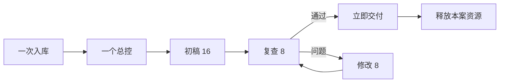

# 轻量运行架构

新批次只走一条主路径。一次入库和冻结规则后，一个总控按 16/8/8 三个池滚动派发。初稿完成进入独立复查，发现问题进入修改，修改后回到新的复查会话。通过的当前稿经过六项检查、全部当前页检查和十项权利要求检查后立即交付，再释放本案占槽和专属进程。

运行时只保留四层职责。

|层|职责|
|---|---|
|总控|manifest、占槽、阶段转换、验收门禁和交付|
|阶段池|每个 case 的一个 attempt，使用冻结阶段包执行|
|证据工具|来源提取、公式对象、DOCX 生成、渲染和真实回执|
|收尾|核对当前稿 SHA、专属进程退出、占槽归零和锁释放|

新批次的阶段包只复制 worker 必需的参考文件。规则正文、来源清单、运行环境、公式资料、Word 生成手册和回执规范保留，历史规则备份、维护说明和测试资料留在技能源目录。旧批次继续使用自己的冻结快照。

总控不撰写、不替 worker 签发通过。复查只读，修改者不能自验。缓存只复用已核验数据，不继承语义通过结论。慢渲染使用现有单写通道，不新增协调器、常驻服务或额外模型池。

普通办案只读本页、批次策略和对应的阶段包。只有发生故障、旧批次接续或技能维护时，才进入完整的 [批处理流程](batch-workflow.md)、[CLI 执行](cli-workers.md) 和 [规则维护](rule-maintenance.md)。
