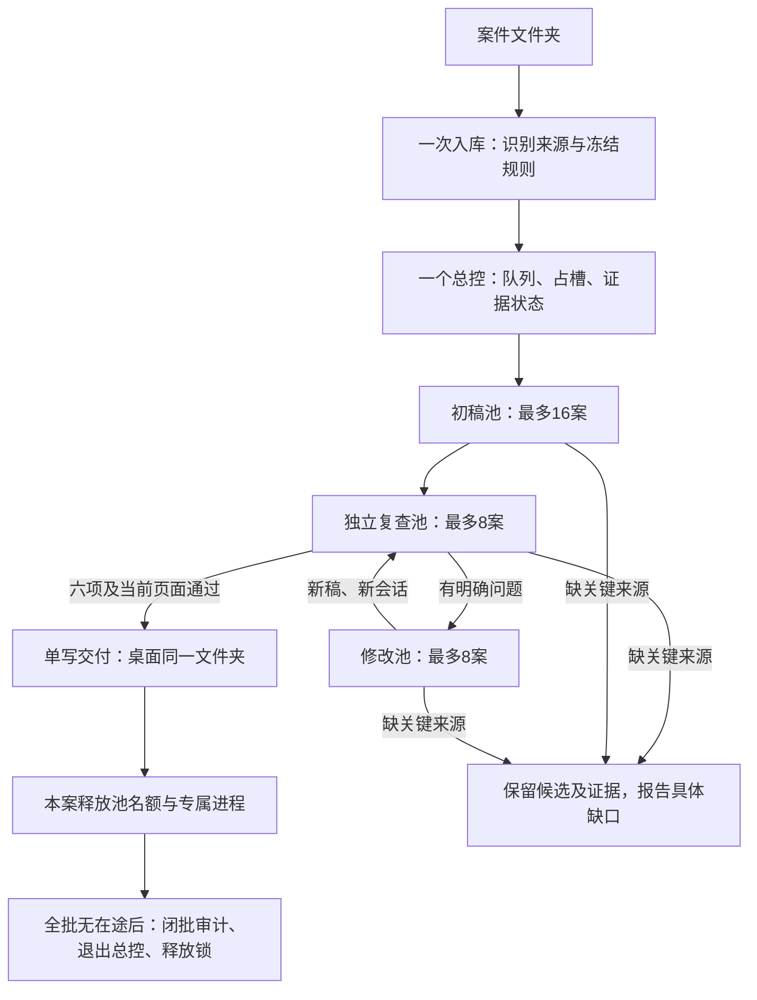

# 三个独立工作池

新批次普通路径先读[轻量运行架构](architecture-lite.md)。本页只在需要容量、故障、旧批次兼容或代码职责细节时读取，不是新增调度层或worker额外必读包。建立批次见[批处理流程](batch-workflow.md)，运行及收尾命令见[CLI池](cli-workers.md)，证据复用细节见[快速执行](fast-execution.md)。

## 架构图

图中箭头表示同案的业务流转；不同案可同时处于三个池，完成就流转，不等整批。缺资料案不进入终稿目录。资源核实属于收尾，不再次审稿；CLI本阶段进程实际退出经核验后才收回执和释放阶段槽。

本地来源提取、DOCX生成、检查、渲染、收稿及复制是工具调用，不增加模型阶段。三个阶段I/O通道、一个交付通道及启用时的一个有限渲染通道均由现有控制器管理；不是另外三套总控，也不是额外模型池。

## 唯一职责

|职责|现有实现|不承担的工作|
|---|---|---|
|状态、阶段转换及验收门禁|`parallel_batch.py`、批次manifest|不撰写、不替模型签通过|
|CLI派发、执行证据、补位及退出|`cli_pool.py`、`stage_pool_runner.py`|不新建第二套队列或协调器|
|冻结规则、阶段包和本案导航|`stage_bundle.py`、`prepare_handoff.py`|不混入后续版本或其他案可写材料|
|初稿、只读复查、按问题修改|每次一个case/attempt的模型CLI|不再下派，不改共享状态|
|提取、生成、渲染及回执|现有公共工具、`worker_receipt.py`|不把工具成功当语义或视觉验收|
|逐案原子交付|`parallel_batch.deliver`、`flat_delivery.py`|不重写已通过稿，不二次付费审查|

批次只有一个状态权威manifest；来源快照、产物、执行记录及回执是该状态所引用的证据。保留启动意图、锁和哈希绑定，不为展示架构另建一套状态表或验收账本。三池隔离可写目录和阶段名额，共用机器、账户与磁盘，不能保证物理资源完全不互相影响。

## 模型与容量

|工作池|默认并行上限|模型|职责|
|---|---:|---|---|
|draft初稿|16|gpt-6.1-sol/high|有据权项及完整初稿、公式正确性校核、一次结构预检|
|review复查|8|gpt-6.1-sol/xhigh|只读初检或修改后独立重验；集中返回findings或pass|
|revise修改|8|gpt-6.1-sol/xhigh|修复findings及关联内容，另存新稿后返回review|

总目标32，最多64案在制。reserved和bound均计槽；CLI与本批collaboration共用上限，同案最多一个活动attempt。初检和重验共享8个review槽，各池不借位超限；只有初稿待办时最多16案，不用32个初稿挤占后续池。达到在制上限只暂停新draft，review/revise继续。

新三池CLI省略--workers读取冻结总目标。--workers是三池总预算，降低时须用--capacity-reason记录真实限制或用户指定；不得把旧4路小样或聊天子代理槽数当上限。至少2槽时按占用/池上限从低到高补位，平手沿用等待及修订优先顺序；只有1槽时优先推进已有案。容量失败后的有界恢复见下节，不换模型、不争抢无关任务资源。配置不代表账户已提供32路能力。

## 一次交接与验收

1. 来源和规则每批冻结一次，准备工具将本案证据路径交给worker；CLI完整内嵌阶段包时直接用，未内嵌才读分块一次。条件规范按需读取，不再逐层通读入口、手册和相同规则。
2. 初稿先处理已知问题再交只读review。review集中列问题，不反复渲染已知待改稿；没有问题直接验收，不强行经过revise。修改后必须使用新attempt、新会话review，修改者不能pass。
3. verified_scope_v1只继承可验证且未受影响的已通过范围；变更、关联、失败和未审范围实际重验。同稿页面核身份后复用，当前六项及全部页面由实查和有效继承完整覆盖才通过。缓存本身不证明通过；未做项如实not_run。
4. 收取一个真实回执后立即进入单写交付，accepted不阻塞其他池补位。正式文件直属唯一桌面批次目录，证据留工作区；不新增格式审查模型、重复提取、同稿渲染或第二份台账。

长I/O在独立通道运行，主清单只短时加锁合并对应案。future完成即唤醒，空闲时以0.2秒间隔观察本地CLI状态；这是等待间隔，不是端到端时延保证。正常reserve已含调度，不在每次前后再plan。

## 故障、退出与旧批兼容

已确认来源或准备问题仅隔离本案；交付目录I/O异常只暂停交付并保留已验收稿。未知进程、身份、哈希或完整性问题停新派发，继续收在途结果；未知attempt保留槽与证据，确认原进程退出前不重放。发布事务持久保存ID，复制与提交中断按原发布记录恢复，不另建目录兜底。

每案交付后立即核该案三池占用归零、专属CLI/supervisor及不再需要的辅助进程实际退出，其他案继续。全批终态且无在途任务后完成历史审计并闭批；启动者还须确认控制器命令结束、线程池退出、锁释放。pool_stopped是退出前日志，不能代替真实退出；分别报告交付与释放，保留共享应用和其他项目。完整方法见[完成即退出](cli-workers.md#完成即退出)。

新批冻结stage_scheduling=separate_stage_pools_v35、review_mode=review_only及pool_execution=nonblocking_handoff_v36。旧overlapped_pipeline_v29保留双区借槽，旧v29/v35无pool_execution仍走原收取、交付及drain，旧review_fix_then_recheck才允许本轮小修返回revised后再独立重验。旧冻结代码、规则、模型和回执不被安装更新改写，兼容工具不因文档精简删除。

## 容量恢复

verified_ramp_v1在原控制器内收完在途、有限冷却，再凭正常阶段真实完成逐级恢复至获准总预算；累计退避与剩余冷却沿事件日志接续，显式低预算不突破，不付费探针或重复阶段。具体次数与命令以[容量接续](cli-workers.md#模型容量不足)为准。

bound_requests_v1使用有限独立渲染I/O及短临时名原子交接；已有合法同稿输出验证后复用，转换异常返回绑定的失败响应，主循环继续收在途结果。按QA-09核当前原始单页及必要局部再决定是否修稿；工具修复按[故障接续](tool-fault-recovery.md)处理，不新增总控、模型池或守护服务。
